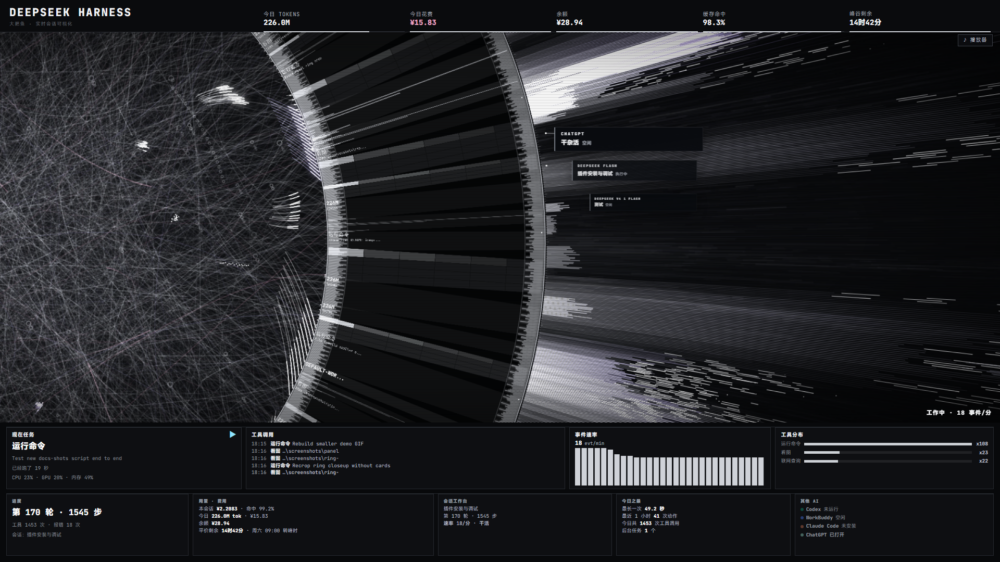

# 安装 · Windows

**4 步，约 5–10 分钟**（含下载 Lively）。装完之后，桌面壁纸上会出现一个跟随 DSH 干活而变化的科幻光环。



> 只看效果、先不装壁纸也行：第 3 步装完就能在浏览器打开 <http://127.0.0.1:7788/> 预览。
> 图片路径是相对仓库根目录的；单独把本文件发给别人时，图片会显示不出来，这是正常的。

---

## 开始之前（30 秒读完）

**需要：**
- Windows 10 / 11（64 位）
- [Node.js](https://nodejs.org) **22 LTS 或更新**（Node 20 也能跑，但 WorkBuddy / Codex 会话标题这类功能会静默降级）
- [Lively Wallpaper](https://www.rocksdanister.com/lively/)（免费，把网页变成桌面壁纸；不装也能用浏览器预览）

**不需要：**
- ❌ Git
- ❌ Python
- ❌ `npm install`（服务端零依赖，只用 Node 内置模块）

**装完之后，你电脑上会多出：**
- 一个**无窗口**的开机自启后台进程（`dsh-hud-start.vbs` → `start.ps1` → 守护进程）
- 一个只监听 `127.0.0.1:7788` 的本地服务（不对外开放、不上传任何数据）
- 所有数据只留在这台电脑上；卸载见文末

---

## 第 1 步 · 装 Node.js

打开 PowerShell，输入：

```powershell
winget install OpenJS.NodeJS.LTS
```

装完**关掉 PowerShell 重开一个**，然后验证：

```powershell
node -v
```

看到 `v22.x.x` 或更高就对了（`v24` 也可以）。

> 用 Node 20 也能启动，但内置的 `node:sqlite` 不可用，WorkBuddy / Codex 卡的标题会退化成"无标题"。

---

## 第 2 步 · 下载并解压

1. 打开仓库页面，点右上角 **Code → Download ZIP**
2. 解压到**一个固定的、以后不会删的目录**，例如：

```
D:\Apps\dsh-hud\
├── dsh-hud\        ← 程序和脚本
└── haloflux\       ← 画面本体
```

⚠️ **两个文件夹必须同级**（都在你解压出来的这一层里），缺一个都跑不起来。

⚠️ 不要放在：桌面、下载文件夹、临时目录、OneDrive 同步目录 —— 路径变动或同步都会让自启失效。

---

## 第 3 步 · 一键安装

在 PowerShell 里 `cd` 到刚才解压的目录（能同时看到 `dsh-hud` 和 `haloflux` 的那一层），运行：

```powershell
powershell -NoProfile -ExecutionPolicy Bypass -File dsh-hud\install.ps1
```

**成功的输出长这样：**

```
== DSH HUD 安装 ==
node: C:\Program Files\nodejs\node.exe
已写入开机自启：C:\Users\你\AppData\Roaming\Microsoft\Windows\Start Menu\Programs\Startup\dsh-hud-start.vbs
服务已启动：rss=48MB

接下来设置壁纸：
  1) 安装 Lively Wallpaper：winget install --id rocksdanister.LivelyWallpaper
  2) Lively -> 添加壁纸 -> URL -> http://127.0.0.1:7788/wall
     （或使用 dsh-hud\wall-proj 作为壁纸工程）
  3) 想换屏幕：Lively.exe setwp --file "<Lively库路径>" --monitor <编号>

预览：http://127.0.0.1:7788/
```

看到 `服务已启动` 就成功了。这个脚本只做 4 件事：

1. 检查 Node 与 `haloflux` 是否齐全
2. 写入开机自启（路径取自当前解压位置；之后挪目录需要重跑一次）
3. 启动后台服务
4. 打印接下来的壁纸设置步骤

**它不会**自动安装 Lively，**也不会**自动选屏（选屏由守护进程在启动时处理）。

---

## 第 4 步 · 接到桌面壁纸上

**先在浏览器里看一眼：** <http://127.0.0.1:7788/>

觉得好看，再装壁纸宿主：

```powershell
winget install --id rocksdanister.LivelyWallpaper
```

然后在 Lively 里二选一：

**方式 B（推荐，兼容性最好）**

```
Lively → 添加壁纸 → 打开工程文件 → 选 dsh-hud\wall-proj（或其中的 LivelyInfo.json）
```

**方式 A（如果你的 Lively 版本有 URL 入口）**

```
Lively → 添加壁纸 → URL / 网页 → 填：http://127.0.0.1:7788/wall
```

装好后，DSH 一开始干活，光环就会转快、光束会爆发。

---

## 怎么确认真的装好了

一条命令：

```powershell
Invoke-RestMethod http://127.0.0.1:7788/stats
```

正常会返回类似：

```
rssMB       : 48
sessions    : 3
clients     : 1
pageFps     : 26.2
```

再打开 <http://127.0.0.1:7788/> —— 能看到光环和底部面板，就是全好了。

重启电脑后想复查，跑这个（共 7 项检查）：

```powershell
powershell -NoProfile -ExecutionPolicy Bypass -File dsh-hud\verify-after-reboot.ps1
```

**全部 `[ OK ]` 的样例：**

```
[ OK ] startup launcher            C:\Users\你\AppData\Roaming\Microsoft\Windows\Start Menu\Programs\Startup\dsh-hud-start.vbs
[ OK ] port 7788 listening         yes
[ OK ] /stats responds             rss=48MB clients=1
[ OK ] /wall renders               151234 bytes
[ OK ] Lively running              pid=12345
[ OK ] wallpaper = HALOFLUX        ...\Lively Wallpaper\WallpaperLayout.json
[ OK ] server node process         pid=23456
RESULT: all checks passed — wallpaper stack survived reboot.
```

---

## 出问题了？先看这 3 个

### ① 壁纸黑屏 / 显示「等待 dsh-hud 服务」

九成是后台服务没起来。

```
双击：dsh-hud\recover-wallpaper.cmd
```

还不行就手动跑 `dsh-hud\start.ps1` 看报错，或检查 `dsh-hud\server.log`。

### ② 关掉 DSH 之后壁纸就没了

别从 DSH 的对话框里启动后台进程（它会被当成子进程一起杀掉）。正常只应从**开机自启**启动；需要重启后台时用：

```powershell
powershell -NoProfile -ExecutionPolicy Bypass -File dsh-hud\stack.ps1
```

### ③ 壁纸跑到别的显示器上了

Lively 的屏幕编号和 Windows 的「显示器 1/2/3」不是一回事，插拔显示器后会变。

```powershell
# 指定主屏（默认是优先 iPad / spacedesk 虚拟屏）
powershell -NoProfile -ExecutionPolicy Bypass -File dsh-hud\fix-wallpaper-screen.ps1 -Prefer primary
```

### 全量问题表

| 现象 | 原因 | 处理 |
|---|---|---|
| 壁纸黑屏 / 「等待 dsh-hud 服务」 | 数据服务没起来 | 双击 `recover-wallpaper.cmd`；看 `server.log` |
| 退出 DSH 后壁纸消失 | 曾从 DSH 命令里启动常驻进程 | 用开机自启重启，或跑 `stack.ps1` |
| 壁纸跑到别的显示器 | Lively 屏幕编号变了 | 用 `fix-wallpaper-screen.ps1 -Prefer primary` |
| 画面卡顿 | 后台资源紧张 | 调 `bridge.js` 的 `devicePixelRatio` / `LOAD` / `quality`（见下） |
| 中文显示成方块 | 缺字体 | 装 MiSans，或改 `bridge.js` 字体栈 |
| 没有声音 | 正常：壁纸自带 BGM 已硬静音 | 播放器面板控制的是系统音乐软件 |
| 重启后全没了 | 项目目录被移动/删除 | 重新跑一次 `install.ps1`（会重写自启路径） |
| 卡片没有标题 | Node 版本低于 22（`node:sqlite` 不可用） | 升级到 Node 22 LTS 或更新 |

---

## 更多功能（不用也能跑）

### Codex / WorkBuddy / Claude Code / ChatGPT 状态接入

如果你的 Codex 支持 Hooks（`codex features list` 里 `hooks` 为 stable / true）：

```powershell
powershell -NoProfile -ExecutionPolicy Bypass -File dsh-hud\install-codex-hooks.ps1
```

然后打开 Codex 桌面版 **设置 → Hooks**，信任 dsh-hud 的条目（只需一次）。
回滚：加 `-Uninstall` 参数，`hooks.json` 会自动备份。

### 想让它优先显示在某块屏

```powershell
# 看当前映射（PowerShell 用 Get-Content，不要用 cmd 的 type）
Get-Content "$env:LOCALAPPDATA\Lively Wallpaper\WallpaperLayout.json"

# 手动指定第 3 块屏
& "C:\Program Files\Lively Wallpaper\Lively.exe" setwp --file "$env:LOCALAPPDATA\Lively Wallpaper\Library\wallpapers\dshhaloflux.001" --monitor 3
```

### 画面卡顿

打开 `dsh-hud\bridge.js`，调这几个值（越小越省）：

| 参数 | 默认 | 可改为 | 说明 |
|---|---|---|---|
| `devicePixelRatio` | `0.95` | `0.8` / `0.7` | 渲染分辨率倍率（约在文件后半段，搜 `Object.defineProperty(window, 'devicePixelRatio'`） |
| `LOAD` | `0.45` | `0.3` | 壁纸模式的整体负载（搜 `const LOAD`） |
| `quality` 上限 | `0.6` | `0.45` | 壁纸模式的细节上限（搜 `quality = Math.min`） |
| 帧节奏 | `20 + 40·(1-AC)^1.6` ms | 把 `40` 调大 | 空闲降频、活跃升频（搜 `Math.pow(1 - AC`） |

---

## 卸载干净

### 方式一：立即卸载（不重启）

```powershell
# 1) 删掉开机自启（下次登录不再拉起）
Remove-Item "$env:APPDATA\Microsoft\Windows\Start Menu\Programs\Startup\dsh-hud-start.vbs" -Force -ErrorAction SilentlyContinue

# 2) 停掉守护进程（否则它 10 秒内会把 node 拉回来）
Get-CimInstance Win32_Process -Filter "Name='powershell.exe'" |
  Where-Object { $_.ProcessId -ne $PID -and $_.CommandLine -match '-File.*daemon\.ps1' } |
  ForEach-Object { Stop-Process -Id $_.ProcessId -Force -ErrorAction SilentlyContinue }

# 3) 停掉 node 数据服务
Get-CimInstance Win32_Process -Filter "Name='node.exe'" |
  Where-Object { $_.CommandLine -match 'server\.mjs' } |
  ForEach-Object { Stop-Process -Id $_.ProcessId -Force -ErrorAction SilentlyContinue }

# 4) 删除项目目录（替换成你自己的解压路径）
Remove-Item 'D:\Apps\dsh-hud' -Recurse -Force
```

> 第 2 步里的 `$_.ProcessId -ne $PID` 是防止脚本误杀自己，别删。

### 方式二：重启后卸载（最省事）

1. 先删掉开机自启（上面第 1 条）
2. 重启电脑
3. 删除项目目录
4. 打开 Lively，右键 `HALOFLUX · DSH LIVE` 壁纸 → **删除**
   （或删除 `%LOCALAPPDATA%\Lively Wallpaper\Library\wallpapers\dshhaloflux.001`）

**不会**残留系统服务、注册表项或计划任务。

---

## 依赖清单（完整版）

### 必需

| 依赖 | 用途 | 安装方式 | 是否自带 |
|---|---|---|---|
| Windows 10/11 x64 | 运行平台 | — | — |
| **Node.js ≥ 22 LTS** | 数据服务 / 静态托管 / SSE / 多平台会话标题 | `winget install OpenJS.NodeJS.LTS` | ❌ |
| PowerShell 5.1 | 媒体控制、ChatGPT 读取、脚本运行 | 系统自带 | ✅ |
| **Lively Wallpaper** | 把页面变成桌面壁纸 | `winget install --id rocksdanister.LivelyWallpaper` | ❌ |
| Edge WebView2 Runtime | Lively 渲染网页壁纸 | 随 Lively / Windows 自动装 | ❌ 一般已有 |
| **HALOFLUX** | 视觉本体 | — | ✅ 仓库里的 `haloflux/` |

> 服务端**零 npm 依赖**，不需要 `npm install`，只用 Node 内置模块。

### 可选（没有也能跑，只是少对应面板）

| 依赖 | 影响的面板 | 缺失时表现 |
|---|---|---|
| **DeepSeek Harness 桌面版** | 主数据源（会话事件、进度、工具流） | 面板无数据，画面保持待命 |
| dsh-cost-meter 插件 | 「用量 · 费用」、顶部花费/余额 | 显示「暂无用量数据」 |
| Codex 桌面版（含 Hooks） | GPT 卡片、工具事件加速 | 显示「Codex 未运行」 |
| WorkBuddy | WorkBuddy 卡片 | 显示「未运行」 |
| Claude Code | Claude Code 卡片 | 显示「未安装」 |
| ChatGPT 桌面版 | ChatGPT 面板/卡片 | 显示「未运行」 |
| QQ 音乐 / Spotify | 左上播放器 | 显示「未检测到播放器」 |
| MiSans / HarmonyOS Sans | 中文排版 | 回退微软雅黑 |
| Wallpaper Engine（付费） | 替代 Lively | 用 Lively 即可 |

---

## 它读你哪些数据

服务端**只读**以下本机数据，全部在本机处理，不上传任何内容：

- `~/.dsh/sessions/**` —— DSH 会话日志（事件、工具调用、token）
- `~/.dsh/storages/cost-meter/ledger.json` —— 用量账本（花费、余额、峰谷）
- `~/.codex/sessions/**`、`~/.codex/session_index.jsonl`、`~/.codex/state_5.sqlite` —— Codex / ChatGPT 桌面版的会话标题与模型
- `~/.workbuddy/projects/**/*.jsonl`、`~/.workbuddy/sessions/*.json`、`~/.workbuddy/workbuddy.db` —— WorkBuddy 会话状态与标题
- `~/.claude/projects/**` —— Claude Code 会话
- Windows 媒体会话（SMTC）—— 当前播放的音乐
- ChatGPT 窗口的 UI Automation 文本 —— 判断运行状态、读取当前对话标题
- `%LOCALAPPDATA%\Lively Wallpaper\WallpaperLayout.json` —— 判断壁纸挂在哪块屏

面板与截图上的绝对路径**只显示最后两段**。不读取任何登录凭据、cookie 或密码。

---

## 后台结构

```
登录
 └→ %Startup%\dsh-hud-start.vbs            （无窗口）
     └→ powershell -File dsh-hud\start.ps1  （一次性：选屏 / 解锁监听 / 确保守护）
         └→ conhost --headless powershell -File dsh-hud\daemon.ps1
             └→ 单实例守护：7788 掉线 → 隐藏启动 node server.mjs（3–10 秒自愈）
```

| 想干什么 | 命令 |
|---|---|
| 壁纸没了 | 双击 `dsh-hud\recover-wallpaper.cmd` |
| 后台彻底重来 | `powershell -File dsh-hud\stack.ps1` |
| 检查是不是单实例 | `powershell -File dsh-hud\stack.ps1` → 输出 `daemon=1 node=1` |

> 全程无窗口；**不要**从 DSH 命令里运行 `daemon.ps1`（会被 DSH 当作子进程杀掉）。

---

## 许可

- **视觉本体**（`haloflux/`）：HALOFLUX by Ryder191（RYDER CODE / Ms MAIKEBAIs CAT，中文网名「麦克白夫人的猫」），
  **PolyForm Noncommercial 1.0.0** —— 仅限个人非商业使用，**严禁商用**。
  原仓库：<https://github.com/Ryder191/haloflux>
- **本项目脚本**（`dsh-hud/`）：**MIT**（见 `LICENSE-MIT`）。
- **壁纸宿主** Lively Wallpaper：**GPL-3.0**，本项目只调用其 CLI，不修改也不分发其源码。
- 完整条款见 [NOTICE.md](NOTICE.md)、[LICENSE](LICENSE)、[LICENSE-MIT](LICENSE-MIT)。

---

遇到文档没写到的问题，开 [Issue](https://github.com/ACyCar1o/dsh-hud-haloflux/issues)，
或看 [CHANGELOG.md](CHANGELOG.md) 了解最近改动。
