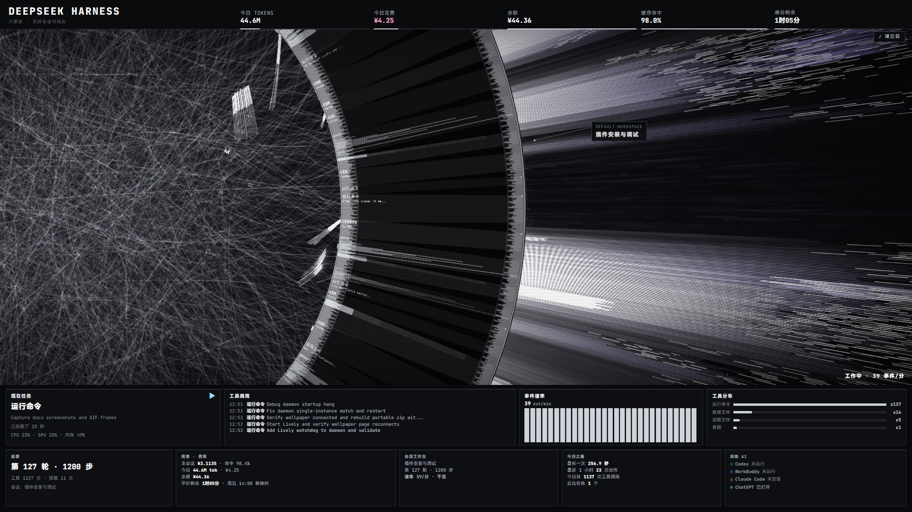
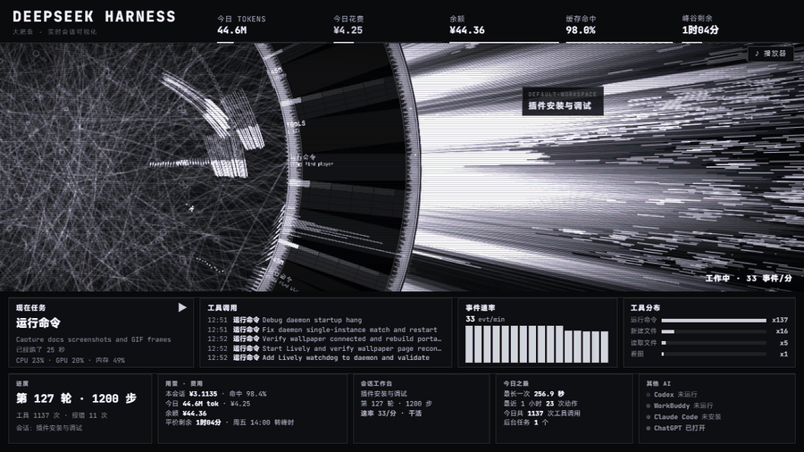
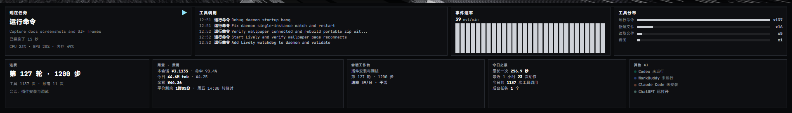
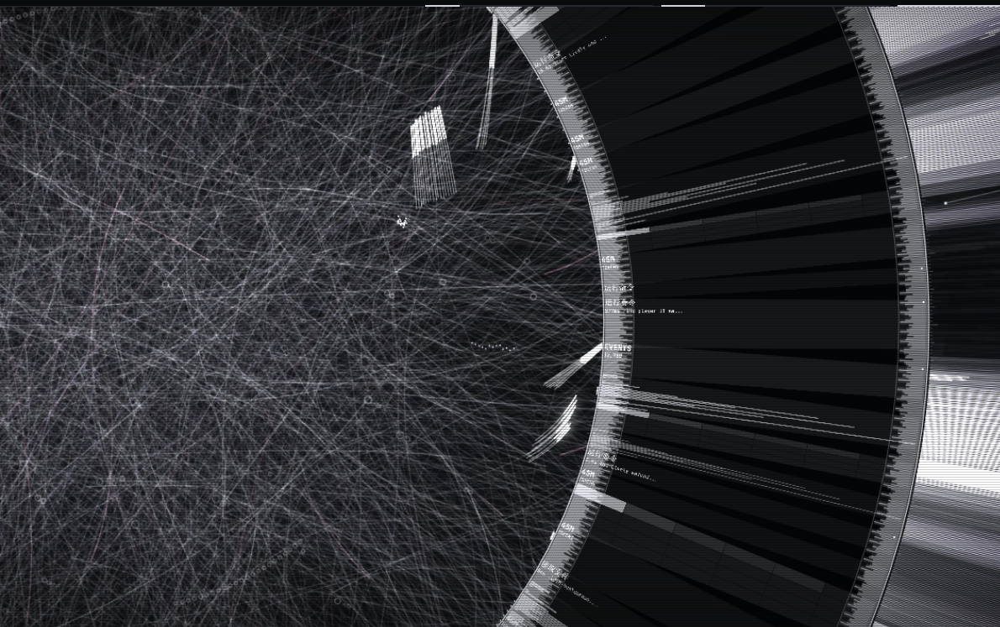
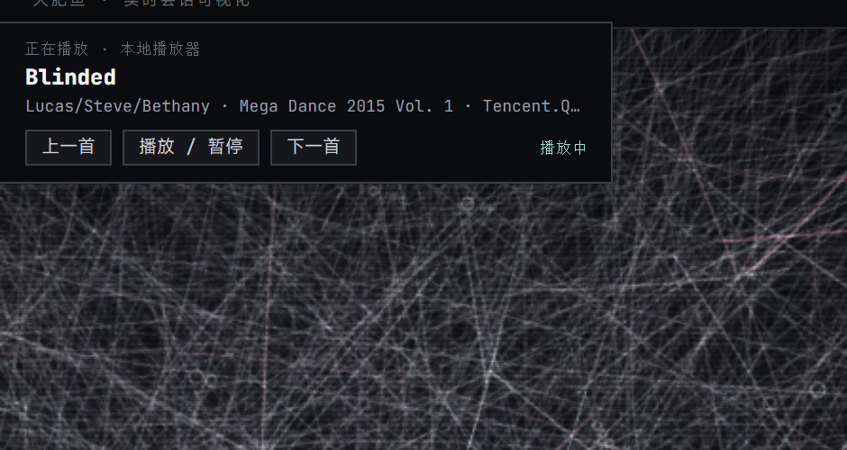

# DSH × HALOFLUX — 实时联动桌面壁纸

**中文** | [English](README.en.md)

把 [HALOFLUX](https://github.com/Ryder191/haloflux)（单文件 Canvas 科幻可视化）接到本机 **DeepSeek Harness** 的真实会话数据上：
轮盘转速、光束爆发、面板数字都由真实事件驱动，空闲时待命慢速、干活时爆发。

同时把**本机播放器**（QQ 音乐 / Spotify…）以及 **Codex / WorkBuddy / Claude Code / ChatGPT**
的状态接进同一画面，最终作为 **Lively Wallpaper** 的桌面壁纸常驻。

> ⚠️ HALOFLUX 采用 **PolyForm Noncommercial** 许可：**仅限个人非商业使用**，详见 [NOTICE.md](NOTICE.md)。
> 署名默认不在画面上显示（`bridge.js` 的 `SHOW_CREDIT = true` 可重新打开）；完整版权信息见 `NOTICE.md` / `LICENSE`。



*真实运行画面：光环随 DSH 会话事件加速、光束爆发；底部「现在任务」带 `CPU · GPU · 内存` 状态行，
右下「其他 AI」同时显示 Codex / WorkBuddy / Claude Code / ChatGPT 的身份色与状态。*



*连续运行时的动图：光束持续爆发、环带加速、面板数字滚动；空闲后自动降为慢速待命。*

## 特性

- **真实数据驱动**：事件速率 → 转速；每次工具调用 → 一次真实光束爆发；报错 → 闪光变密
- **多 AI 同屏**：「其他 AI」面板显示 Codex / WorkBuddy / Claude Code / ChatGPT 的身份色与实时状态
- **人话面板**：现在任务 / 进度 / 工具调用 / 会话工作台 / 今日之最 / 其他 AI / 事件速率 / 工具分布
- **用量费用**：今日 tokens、花费、余额、缓存命中、峰谷剩余（读 `dsh-cost-meter` 账本）
- **机器状态**：CPU / GPU / 内存占用直接读 Lively 宿主 API（每秒刷新，零额外开销）
- **本地播放器**：读取系统媒体会话，可上一首 / 播放暂停 / 下一首，面板可收起
- **自动选屏**：优先 iPad（spacedesk 虚拟屏），否则主屏；插拔显示器不用手动改编号
- **隐私友好**：面板上的绝对路径只显示末两段（截图可分享）
- **空闲休眠**：60 秒无数据自动停渲染；Lively 暂停时同样停
- **静默后台**：开机零窗口（`conhost --headless` + 单实例守护），node 掉线 3–10 秒自愈



*底部两行面板：现在任务（含机器状态）/ 工具调用 / 事件速率 / 工具分布 +
进度 / 用量 · 费用 / 会话工作台 / 今日之最 / 其他 AI。*



*光环特写：环上数据卡来自真实 token 与工具事件，路径已脱敏。*



*本地播放器：读取 Windows 媒体会话（QQ 音乐 / Spotify 等），可上一首 / 播放暂停 / 下一首。*


## 字体规范

全站统一：**JetBrains Mono（数字/英文）→ MiSans → HarmonyOS Sans SC → 微软雅黑**。

| 层级 | 用途 | 字号 | 字重 | 颜色 |
|---|---|---|---|---|
| Display | 「现在任务」动词、「进度」主数字 | 16px | 800 | `#ffffff` |
| 面板标题 | 各面板标题 | 10px（小窗 8.5px） | 800 | `#e8eaee` / 小窗 `#9aa0aa` |
| 正文 | 列表行、描述 | 9.5px | 400 | `#b9bec7` |
| 强调 | 动词、关键数值 | 9.5px | 700 | `#ffffff` |
| 弱化 | 时间戳、单位、辅助说明 | 9.5px | 400 | `#8d939c` |
| 图表标签 | 工具分布、环带卡片 | 9.5px | 700 | `#e8eaee` |
| 统计数字 | 事件速率、计数 | 9.5–11px（等宽） | 700 | `#ffffff` |
| 环带 | 圆环上的数据卡（受带宽限制） | 9px / 6px | 800 / 500 | 白 100% / 90% |

原则：**同一层级只能有一个字号和字重**；正文里的动词/数值统一加粗提白，辅助信息统一压灰。

所有文字（含图表标签、计数、事件速率数值）都用 **DOM 渲染**，canvas 只画柱状/热力等图形，从根上保证字体与面板完全一致。

> 当前版本见 [`VERSION`](VERSION) · 每个版本修了什么见 [CHANGELOG.md](CHANGELOG.md)


## ⚠️ 与 DSH 的进程管理冲突（重要）

DSH 在 Windows 上会把**每条命令的整棵进程树**塞进一个 `KILL_ON_JOB_CLOSE` 的 Job：

- 从命令里起的常驻进程（Lively、数据服务、守护脚本）会落进 Job，Job 关闭时被一起杀掉 → **壁纸突然消失**；
- 常驻进程不退出 → Job 永远不空 → **那条命令永远不返回**（会话卡住）；
- 卡住的命令会让 DSH 自动更新的"任务排空"检查 10 秒超时（`desktop update: task inspection timed out`）。

所以本项目**不从 DSH 命令里启动常驻进程**：它们由开机启动项拉起，并用 `conhost.exe --headless`
托管（实测零窗口）。日常恢复壁纸用 `dsh-hud\recover-wallpaper.cmd`；
维护后台用 `dsh-hud\stack.ps1`（清理重复实例、重启守护、跑一次自愈测试）。

## 快速开始

```powershell
# 1. 装 Node.js 20+（只需要它，服务端零第三方依赖）
winget install OpenJS.NodeJS.LTS

# 2. 解压本项目，运行安装脚本（自动写开机自启 + 启动服务）
powershell -NoProfile -ExecutionPolicy Bypass -File dsh-hud\install.ps1

# 3. 装 Lively Wallpaper
winget install --id rocksdanister.LivelyWallpaper

# 4. Lively -> 添加壁纸 -> URL -> http://127.0.0.1:7788/wall
```

详见 [INSTALL.md](INSTALL.md)。

## Codex Hooks（可选，反应更快更准）

默认靠轮询 `~/.codex/sessions` 判断 Codex 活动。如果装了 Codex 桌面版（支持 Hooks），
可以再加一层**事件推送**：工具开始/结束、提交、停止都会即时通知壁纸，不用等轮询。

```powershell
# 安装（用户级，自动备份 hooks.json；回滚用 -Uninstall）
powershell -NoProfile -ExecutionPolicy Bypass -File dsh-hud\install-codex-hooks.ps1
```

安装后在 **Codex 桌面版 → 设置 → Hooks** 里把 dsh-hud 的条目点一次「信任」即可。

- 覆盖事件：`UserPromptSubmit / PreModelRequest / PostModelRequest / PreToolUse / PostToolUse / PermissionRequest / Stop / Interrupt`
- 转发链：Codex Hook → `dsh-hud\codex-hook.mjs`（<1 秒退出）→ `POST http://127.0.0.1:7788/hook` → 壁纸立即打光束
- 不读 prompt / 代码 / 工具输入输出，只转事件名与工具名

## 后台运行与自愈

```
登录 → %Startup%\dsh-hud-start.vbs（ASCII、无窗口）
        → conhost.exe --headless powershell -File dsh-hud\daemon.ps1
             → 单实例守护（文件锁）
                  ├─ 7788 不在监听 → 隐藏启动 node server.mjs（掉线 3–10 秒内拉起）
                  └─ 启动时调用 fix-wallpaper-screen.ps1 选屏
```

| 脚本 | 作用 |
|---|---|
| `dsh-hud/daemon.ps1` | 守护：node 掉线自动重启，日志写 `server.log` |
| `dsh-hud/stack.ps1` | 维护：清理重复守护/node，重启一份干净的，并做自愈测试 |
| `dsh-hud/recover-wallpaper.cmd` | 壁纸丢了双击恢复（重载 + 选屏 + 打开预览） |
| `dsh-hud/start.ps1` | 一次性设置：选屏 + 解锁监听 + 确保守护在跑（不常驻） |

> 不需要管理员权限、不需要计划任务；也不要从 DSH 命令里直接运行 `daemon.ps1`（它会被当成命令子进程）。

## 目录

| 路径 | 说明 |
|---|---|
| `dsh-hud/server.mjs` | 数据服务：会话增量解码、SSE、媒体/外部 AI/用量/多 Agent 探针 |
| `dsh-hud/bridge.js` | 注入 HALOFLUX 的桥：联动、面板、中文化、壁纸模式 |
| `dsh-hud/agents.mjs` | 多 Agent 探针：Codex / WorkBuddy / Claude Code（只读本机会话） |
| `dsh-hud/workbuddy-probe.ps1` | WorkBuddy OCR 备用探针（主路径走事件流，平时不运行） |
| `dsh-hud/external.ps1` | ChatGPT 桌面版状态（UI Automation） |
| `dsh-hud/media.ps1` | 系统媒体会话读写（上下曲/播放暂停） |
| `dsh-hud/fix-wallpaper-screen.ps1` | 自动选择壁纸屏幕（spacedesk/iPad 优先，否则主屏） |
| `dsh-hud/daemon.ps1` | 无窗口守护：node 掉线自动重启 |
| `dsh-hud/stack.ps1` | 后台维护：清重复实例 + 重启 + 自愈测试 |
| `dsh-hud/wall-proj/` | Lively / Wallpaper Engine 壁纸工程 |
| `dsh-hud/install.ps1` | 一键安装（写开机自启 + 启动守护 + 自动选屏） |
| `dsh-hud/verify-after-reboot.ps1` | 重启后自检 |
| `haloflux/` | HALOFLUX 原始视觉（未改动，服务端运行时注入 bridge） |
| `CHANGELOG.md` | 每个版本修了什么 |

## 架构

```
~/.dsh/sessions/<workspace>/session-*.jsonl.zstd      ~/.codex · ~/.workbuddy · ~/.claude
        │ 每 500ms 增量解码（多帧 zstd）                 │ 只读探针（agents.mjs）
        └───────────────────────┬────────────────────────┘
                                ▼
                  dsh-hud/server.mjs  (127.0.0.1:7788)
                                │ SSE /stream · JSON /state /usage /media /external
                                ▼
                  haloflux/lab.html + 运行时注入 bridge.js
                                │ setParam() / onBeat() 驱动内部参数
                                ▼
                  Lively Wallpaper（WebView2）→ iPad 桌面壁纸
```

## 性能（本机实测，3840×2160 / i9-14900KF）

| 场景 | CPU | 内存 |
|---|---|---|
| 数据服务 | ≈0.3% 单核 | 70–110 MB |
| 壁纸 · 待命 | ≈2–4% 单核 | ≈0.8–1.1 GB |
| 壁纸 · 工作中 | ≈30–41% 单核 | ≈1.1–1.3 GB |

> 内存大头是 Lively/WebView2 基线（换任何壁纸都差不多）。
> 可在 `bridge.js` 调 `devicePixelRatio`、帧率、`LOAD` 进一步降载。

## 作者与致谢

- **项目作者**：**竹子Away（ACyCar1o）** · [B 站主页](https://space.bilibili.com/8124574) · [GitHub](https://github.com/ACyCar1o)
- **视觉原作**：**HALOFLUX** by **Ryder191**（`RYDER CODE / Ms MAIKEBAIs CAT`，B 站：**麦克白夫人的猫**）
  - [GitHub 仓库](https://github.com/Ryder191/haloflux) · [B 站主页](https://space.bilibili.com/485939159) · [原作演示视频（B 站）](https://www.bilibili.com/video/BV1dhn163E2V)
- 感谢在 HALOFLUX 之上做 DSH 移植与 HUD 探索的社区项目（见文末 [相关项目](#相关项目)）

## 许可与权益（务必阅读）

| 部分 | 许可 | 能不能商用 | 要求 |
|---|---|---|---|
| **视觉引擎** `haloflux/` | HALOFLUX **PolyForm Noncommercial 1.0.0** | ❌ **严禁任何商业用途** | 必须保留版权声明、注明作者与仓库链接 |
| **二次开发脚本** `dsh-hud/` | **MIT**（见 `LICENSE-MIT`） | ✅ 可用（但视觉部分仍受上一条约束） | 保留版权与许可声明 |
| **背景音乐** `haloflux/audio/` | 原作者以 **CC0** 发布 | ✅ | 无 |
| **你的数据** | 只留本机 | — | 不读取登录凭据，不上传任何内容 |

**「商业用途」具体包括**（原作明文列举）：在公司内部或代表公司使用、集成到商业产品/服务、接单或有偿项目、
出售软件或它的产出（**付费壁纸、模板、素材、视频**）、**商业广告与推广**。原作不提供任何商业授权。

**转发到壁纸平台**（Steam 创意工坊 / Wallpaper Engine / Lively 等）时：简介里必须直接写
`Original work: HALOFLUX by Ryder191 (RYDER CODE / Ms MAIKEBAIs CAT)` 和
`Source: https://github.com/Ryder191/haloflux`，不得冒充原创、不得以任何形式盈利，并附带 `LICENSE`。

**发到抖音 / B 站 / 小红书 / YouTube / X 等平台**：必须在**文案、标题或简介**里直接注明
`来源：HALOFLUX，作者 Ryder191 - https://github.com/Ryder191/haloflux`（不能只写在评论区）；
平台不允许放链接时写 `GitHub：Ryder191/haloflux`。未注明来源的分享不在许可范围内。

- 完整条款见 **[NOTICE.md](NOTICE.md)** 与 **[LICENSE](LICENSE)**（`LICENSE` 与上游逐字节一致）。
- 画布上的署名默认**隐藏**（`bridge.js` 里 `SHOW_CREDIT = true` 可恢复显示），署名信息保留在 README / NOTICE 中。

## 相关项目

**本项目实际用到的（唯一依赖）**

- [Ryder191/haloflux](https://github.com/Ryder191/haloflux) — 视觉引擎。本仓库的 `haloflux/` 就是它的原始文件，运行时注入 `bridge.js`

**看过并借鉴过思路的（没有使用它们的代码）**

- [Ke-wood/dsh-haloflux](https://github.com/Ke-wood/dsh-haloflux) — 最早把 HALOFLUX 接进 DSH Web GUI，验证了"用会话数据驱动光环"这个方向可行
- [Michael-ZAG/dsh-haloflux](https://github.com/Michael-ZAG/dsh-haloflux) — HUD 面板布局 / 相位环 / 上下文弧等探索，给了面板设计的参考
- [b1ub1u/dsh-hud-haloflux-live2](https://github.com/b1ub1u/dsh-hud-haloflux-live2) — 多平台 AI 同屏；它记录的
  "`setwp --file reload` 会泄漏一个 2–3.5GB WebView 进程"的实测结论，直接影响了本项目的守护策略（改为干净重启 + 限频）
- [caihao373-star/agent-halo](https://github.com/caihao373-star/agent-halo) — 多智能体监控与"规划进度环"，是「其他 AI」面板的思路来源

> 除 HALOFLUX 外，其余项目**均未复制代码**，只作为方向与经验参考；它们的许可以各自仓库为准。
