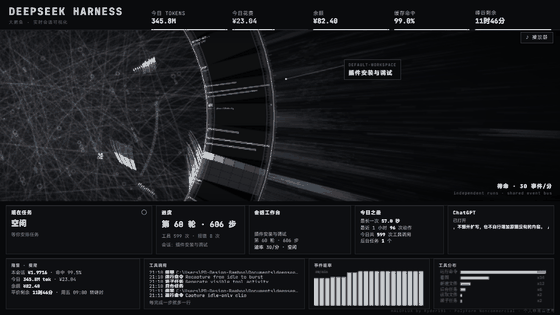
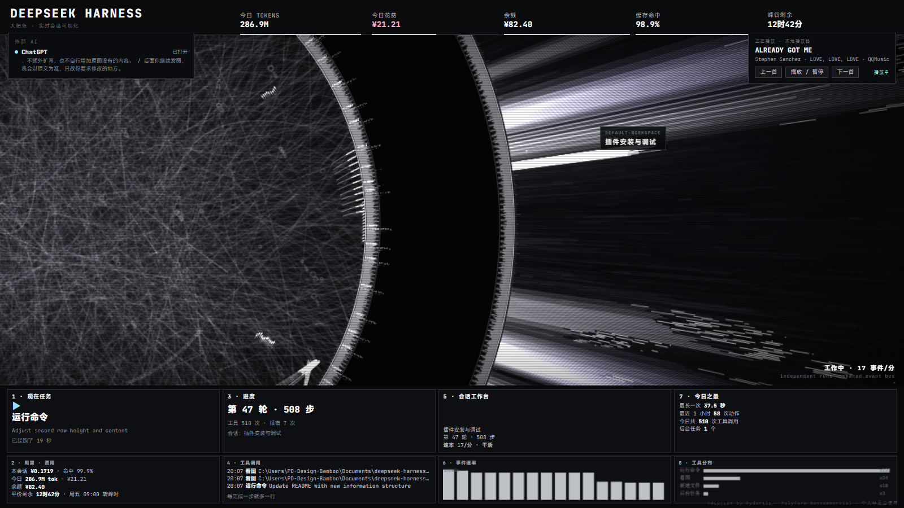

# DSH × HALOFLUX — 实时联动桌面壁纸

**中文** | [English](README.en.md)

把 [HALOFLUX](https://github.com/Ryder191/haloflux)（单文件 Canvas 科幻可视化）接到本机 **DeepSeek Harness** 的真实会话数据上：
轮盘转速、光束爆发、面板数字都由真实事件驱动，空闲时待命慢速、干活时爆发。

同时把**本机播放器**（QQ 音乐 / Spotify…）和 **ChatGPT 桌面版**状态接进同一画面，
最终作为 **Lively Wallpaper** 的桌面壁纸常驻。

> ⚠️ HALOFLUX 采用 **PolyForm Noncommercial** 许可：**仅限个人非商业使用**，详见 [NOTICE.md](NOTICE.md)。
> 画布右下角保留署名 `HALOFLUX by Ryder191`。



*空闲时慢速待命；一跑工具就光束爆发、环带加速、面板数字滚动。*

## 特性

- **真实数据驱动**：事件速率 → 转速；每次工具调用 → 一次真实光束爆发；报错 → 闪光变密
- **空闲待命**：4 秒无事件即降为慢速漂移（10% 时间轴），不空转
- **人话面板**：现在任务 / 进度 / 工具调用 / 会话工作台 / 今日之最 / ChatGPT / 事件速率 / 工具分布
- **用量费用**：今日 tokens、花费、余额、缓存命中、峰谷剩余（读 `dsh-cost-meter` 账本）
- **本地播放器**：读取系统媒体会话，可上一首 / 播放暂停 / 下一首，面板可收起
- **自动选屏**：优先 iPad（spacedesk 虚拟屏），否则主屏；插拔显示器不用手动改编号
- **中文界面**：MiSans 中文 + JetBrains Mono 英文数字
- **壁纸化**：Lively / Wallpaper Engine 专用工程，断线自动重试



## 快速开始

```powershell
# 1. 装 Node.js 20+（只需要它，服务端零第三方依赖）
winget install OpenJS.NodeJS.LTS

# 2. 解压本项目，运行安装脚本（自动写开机自启 + 启动服务）
powershell -NoProfile -ExecutionPolicy Bypass -File dsh-hud\install.ps1

# 3. 装 Lively Wallpaper
winget install --id rocksdanister.LivelyWallpaper

# 4. Lively -> 添加壁纸 -> URL -> http://127.0.0.1:7788/wall
```

详见 [INSTALL.md](INSTALL.md)。

## 目录

| 路径 | 说明 |
|---|---|
| `dsh-hud/server.mjs` | 数据服务：会话增量解码、SSE、媒体/外部 AI/用量代理 |
| `dsh-hud/bridge.js` | 注入 HALOFLUX 的桥：联动、面板、中文化、壁纸模式 |
| `dsh-hud/fix-wallpaper-screen.ps1` | 自动选择壁纸屏幕（spacedesk/iPad 优先，否则主屏） |
| `dsh-hud/media.ps1` | 系统媒体会话读写（上下曲/播放暂停） |
| `dsh-hud/external.ps1` | ChatGPT 桌面版状态（UI Automation） |
| `dsh-hud/ocr.ps1`、`capture-window.ps1` | Windows OCR / 窗口抓图（备用通道） |
| `dsh-hud/wall-proj/` | Lively / Wallpaper Engine 壁纸工程 |
| `dsh-hud/install.ps1` | 一键安装（自启 + 启动 + 自动选屏） |
| `dsh-hud/capture-gif.mjs` | 演示 GIF 录制（CDP 截帧） |
| `dsh-hud/verify-after-reboot.ps1` | 重启后自检 |
| `haloflux/` | HALOFLUX 原始视觉（未改动，服务端运行时注入 bridge） |

## 架构

```
~/.dsh/sessions/<workspace>/session-*.jsonl.zstd
        │ 每 500ms 增量解码（多帧 zstd）
        ▼
dsh-hud/server.mjs  (127.0.0.1:7788)
        │ SSE /stream · JSON /state /usage /media /external
        ▼
haloflux/lab.html + 运行时注入 bridge.js
        │ setParam() / onBeat() 驱动内部参数
        ▼
Lively Wallpaper（WebView2）→ 桌面壁纸
```

## 性能（本机实测，3840×2160 / i9-14900KF）

| 场景 | CPU | 内存 |
|---|---|---|
| 数据服务 | ≈0.3% 单核 | 60–110 MB |
| 壁纸 · 待命 | ≈4% 单核 | ≈1.0–1.2 GB |
| 壁纸 · 工作中 | ≈30–41% 单核 | ≈1.2–1.3 GB |

> 内存大头是 Lively/WebView2 基线（换任何壁纸都差不多）。
> 可在 `bridge.js` 调 `devicePixelRatio`、帧率、`LOAD` 进一步降载。

## 许可

- 视觉：HALOFLUX by Ryder191，PolyForm Noncommercial（**禁止商业用途**）
- 二次开发脚本：MIT（见 `LICENSE-MIT`），分发请保留非商业性质与署名
